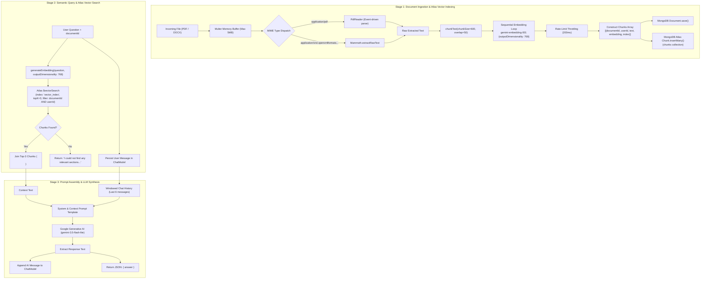

# IntelliDoc RAG Architecture Technical Report

## 1. Executive Summary & Architecture Overview

This report provides a clear, focused architectural breakdown of the **Retrieval-Augmented Generation (RAG)** pipeline of the IntelliDoc system, running natively on **MongoDB Atlas (Free M0 Tier)**. This analysis excludes frontend presentation and user authentication layers to focus strictly on document ingestion, vectorization, Atlas Vector Search storage, query processing, semantic retrieval, and response synthesis.

IntelliDoc implements a clean, standard **Vector RAG pipeline**:
1. **Sliding-Window Text Chunking** with configurable chunk sizes and overlap.
2. **Dense Vector Embeddings** powered by Google Generative AI (`gemini-embedding-001`), explicitly constrained to 768 dimensions.
3. **MongoDB Atlas Vector Search**:
   - Chunks stored as standalone documents in a dedicated `chunks` collection ([ChunkModel.js](file:///c:/Users/NITIN%20SINGH/Documents/IntelliDoc/Server/models/ChunkModel.js)).
   - Vector search index (`vector_index`) configured with cosine similarity.
   - Compound pre-filtering scoped by both `documentId` and `userId` (`ObjectId`).
4. **Pure Vector Retrieval**:
   - Direct Approximate Nearest Neighbor (ANN) search via MongoDB Atlas `$vectorSearch`.
   - If no relevant sections match the query, the system explicitly reports no relevant context found rather than hallucinating or stuffing raw document text.
5. **Contextual History Augmentation**: Recent dialogue history is injected alongside top-$k$ retrieved chunks into `gemini-3.5-flash-lite`.
6. **Sequential Cascading Deletion**: Clean cascading purge across MongoDB documents, chat sessions, and chunk vectors.

---

## 2. End-to-End Pipeline Architecture



---

## 3. Deep Dive: Ingestion, Chunking & Embeddings

The ingestion flow is handled by `uploadDocument` in [DocumentController.js](file:///c:/Users/NITIN%20SINGH/Documents/IntelliDoc/Server/controllers/DocumentController.js).

### 3.1 Input Validation & Buffering
- **Transport**: Express route `POST /api/documents/upload` backed by `multer({ storage: multer.memoryStorage() })`.
- **Buffer Retention**: Files are buffered strictly in RAM as `req.file.buffer` without writing temporary files to disk.
- **Constraints**: Hard cap at $5\text{ MB}$ (`req.file.size > 5 * 1024 * 1024`), returning `HTTP 400` on violation.

### 3.2 Text Extraction
- **PDF Extraction**: Processed via `pdfreader` through an event-based parser.
- **DOCX Extraction**: Processed via `mammoth.extractRawText({ buffer: req.file.buffer })`.
- **Validation**: If extraction produces empty text, returns `HTTP 400` immediately.

### 3.3 Text Chunking Algorithm
Located in [vectorUtils.js](file:///c:/Users/NITIN%20SINGH/Documents/IntelliDoc/Server/vectorUtils.js):
```javascript
export const chunkText = (text, chunkSize = 600, overlap = 50) => {
    const chunks = [];
    let start = 0;
    
    while (start < text.length) {
        const end = Math.min(start + chunkSize, text.length);
        const chunk = text.slice(start, end);
        chunks.push(chunk);
        if (end >= text.length) break;
        start = end - overlap;
    }
    
    return chunks;
};
```
- **Chunk Size ($C$)**: 600 characters.
- **Overlap ($O$)**: 50 characters ($8.33\%$ overlap ratio).
- **Step Size ($S$)**: $S = C - O = 550$ characters.
- **Continuity**: The sliding window ensures phrases spanning chunk boundaries remain semantically complete.

### 3.4 Vector Embedding Generation
Embedding computation is defined in [vectorUtils.js](file:///c:/Users/NITIN%20SINGH/Documents/IntelliDoc/Server/vectorUtils.js):
- **Model**: `gemini-embedding-001` via `@google/generative-ai`.
- **Dimensionality Constraint**: By default, `gemini-embedding-001` produces 3072-dimensional vectors. The generator explicitly specifies `outputDimensionality: 768`:
  ```javascript
  const result = await model.embedContent({
      content: { parts: [{ text }] },
      outputDimensionality: 768
  });
  ```
  This guarantees strict dimension alignment with the Atlas index schema (`numDimensions: 768`).
- **Retry Mechanism**: 3 maximum attempts with linear backoff:
  $$\text{Delay} = 1000 \times (i + 1)\text{ ms}$$
- **Rate-Limit Throttling**: Chunks are vectorized sequentially with a $200\text{ ms}$ pause between calls to respect API quotas.

### 3.5 Storage Architecture in MongoDB Atlas
1. **Parent Document ([DocumentModel.js](file:///c:/Users/NITIN%20SINGH/Documents/IntelliDoc/Server/models/DocumentModel.js))**:
   - Stores metadata: `userId`, `filename`, `content`, `totalChunks`, `indexedChunks`, `status`.
2. **Chunk Collection ([ChunkModel.js](file:///c:/Users/NITIN%20SINGH/Documents/IntelliDoc/Server/models/ChunkModel.js))**:
   - Stores each chunk as an isolated document:
     ```javascript
     {
       documentId: ObjectId,
       userId: ObjectId,
       text: String,
       embedding: [Number], // 768-dim float vector
       index: Number
     }
     ```
   - **Scalability**: Eliminates the 16MB single-document BSON limit on large PDFs and allows direct vector index traversal.

---

## 4. Deep Dive: Query, Retrieval & Semantic Search

When a query arrives at `POST /api/documents/query`, the following workflow runs inside [DocumentController.js](file:///c:/Users/NITIN%20SINGH/Documents/IntelliDoc/Server/controllers/DocumentController.js):

### 4.1 Chat State & Dialogue Recording
- The active session is fetched using `{ userId: req.user._id, documentId }`.
- User question is appended to `chat.messages` with `{ type: 'user', content: question }` and saved immediately.

### 4.2 Query Vectorization
The question is transformed into a 768-dimensional vector via `generateEmbedding(question)`.

### 4.3 Atlas Vector Search (`$vectorSearch`)
Executed directly on the `chunks` collection:
```javascript
const relevantChunks = await Chunk.aggregate([
    {
        $vectorSearch: {
            index: 'vector_index',
            path: 'embedding',
            queryVector: questionEmbedding,
            numCandidates: 30,
            limit: 3,
            filter: {
                $and: [
                    { documentId: { $eq: new mongoose.Types.ObjectId(documentId) } },
                    { userId: { $eq: new mongoose.Types.ObjectId(req.user._id) } }
                ]
            }
        }
    },
    {
        $project: {
            text: 1,
            index: 1,
            score: { $meta: 'vectorSearchScore' }
        }
    }
]);
```
- **Compound Pre-Filtering (Defense-in-Depth)**: Pre-filters search space by both `documentId` and `userId` *before* nearest-neighbor calculation runs. This prevents cross-tenant data leakage.
- **Empty Retrieval Handling**: If no chunks are found matching the query, the system cleanly returns:
  `"I could not find any relevant sections in this document to answer your question."`
- **Context Assembly**: If chunks match, top-3 chunk texts are joined with `\n\n`.

---

## 5. Deep Dive: Prompt Engineering & Generation Layer

### 5.1 Conversation History Windowing
Extracts the last 6 messages to preserve a 3-turn dialogue window:
```javascript
const recentMessages = chat.messages.slice(-6);
const chatHistory = recentMessages.map(msg => `${msg.type}: ${msg.content}`).join('\n');
```

### 5.2 Prompt Structure & Generation
- **Model**: `gemini-3.5-flash-lite` via `@google/generative-ai`.
- **System Directives**: Instructions enforcing Markdown structure, bold key points, technical code blocks, numbered sequences, and bullet points.
- **State Persistence**:
  1. AI response is appended to `chat.messages` with `{ type: 'ai', content: aiResponse }`.
  2. `chat.updatedAt` is updated and saved.
  3. `Document.findByIdAndUpdate(documentId, { updatedAt: new Date() })` refreshes the document's timestamp.
  4. Response is returned as `{ answer: aiResponse }`.

---

## 6. Document Lifecycle & Cleanup

When a document is deleted via `DELETE /api/documents/:documentId`:

```javascript
await Document.findOneAndDelete({ _id: documentId, userId: req.user._id });
await Chat.findOneAndDelete({ userId: req.user._id, documentId });
await Chunk.deleteMany({ documentId, userId: req.user._id });
```
All document metadata, chat history, and vector embeddings are removed in sequential cascading steps.

---

## 7. Atlas Vector Search Index Configuration

To enable Approximate Nearest Neighbor (ANN) Vector Search on MongoDB Atlas:

### Atlas Search Index Definition
- **Collection**: `chunks` (Database: `intellidoc`)
- **Index Name**: `vector_index`
- **Definition (JSON)**:
```json
{
  "fields": [
    {
      "type": "vector",
      "path": "embedding",
      "numDimensions": 768,
      "similarity": "cosine"
    },
    {
      "type": "filter",
      "path": "documentId"
    },
    {
      "type": "filter",
      "path": "userId"
    }
  ]
}
```

---

## 8. Architectural Strengths

1. **Simplicity & Predictability**:
   - Single retrieval path through MongoDB Atlas Vector Search. No complex fallback layers, in-memory scans, or unpredictable head-truncation logic.
2. **Cloud-Native Unified Architecture**:
   - All document metadata, user sessions, chat history, and dense vector embeddings reside within MongoDB Atlas. No external vector services or background daemons are needed.
3. **Defense-in-Depth Pre-Filtering**:
   - Queries scope candidate vectors by both `{ documentId, userId }` before ANN calculation, preventing cross-tenant data exposure.
4. **Strict Dimension Alignment**:
   - Explicitly configuring `outputDimensionality: 768` on `gemini-embedding-001` ensures 100% compatibility with the Atlas index schema.
5. **No Hallucination on Zero Context**:
   - If the vector index finds no matches, the system explicitly answers that no relevant sections were found rather than guessing.
