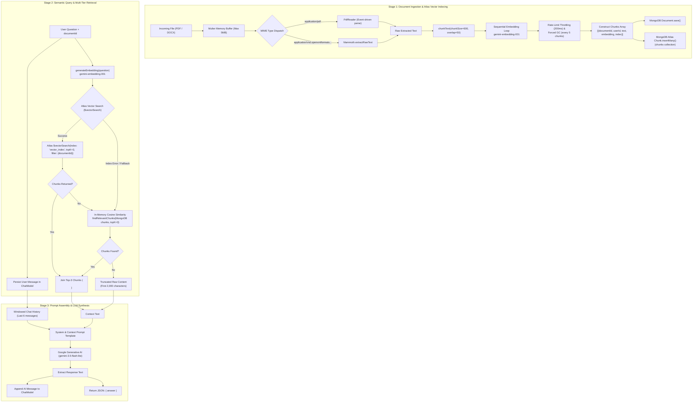
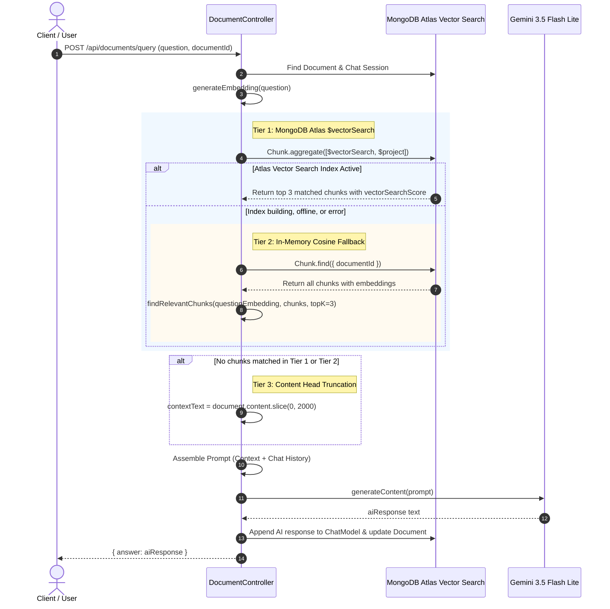

# IntelliDoc RAG Architecture Technical Report

## 1. Executive Summary & Architecture Overview

This report provides an in-depth architectural breakdown of the **Retrieval-Augmented Generation (RAG)** pipeline of the IntelliDoc system, hosted entirely on **MongoDB Atlas (Free M0 Tier)**. This analysis excludes frontend presentation and user authentication layers to focus strictly on document ingestion, vectorization, Atlas Vector Search storage, query processing, semantic retrieval, and response synthesis.

IntelliDoc implements an end-to-end **cloud-native, hybrid RAG pipeline** designed for zero-infrastructure overhead, high reliability, low-latency semantic search, and robust conversational grounding:
1. **Sliding-Window Text Chunking** with configurable chunk sizes and overlap.
2. **Dense Vector Embeddings** powered by Google Generative AI (`gemini-embedding-001`).
3. **MongoDB Atlas Vector Search**:
   - Chunks stored in dedicated `chunks` collection ([ChunkModel.js](file:///c:/Users/NITIN%20SINGH/Documents/IntelliDoc/Server/models/ChunkModel.js)).
   - Atlas Vector Search index (`vector_index`) configured with HNSW indexing and cosine metric.
   - Pre-filtering scoped directly by `documentId` (`ObjectId`).
4. **Resilient Multi-Tiered Retrieval Engine**:
   - **Tier 1**: Hardware-accelerated ANN vector search via MongoDB Atlas `$vectorSearch`.
   - **Tier 2 (Fallback)**: In-memory exact Cosine Similarity search over MongoDB chunk vectors if the Atlas index is still building or offline.
   - **Tier 3 (Safety Net)**: Head truncation (`content.slice(0, 2000)`) if no chunks exist.
5. **Contextual History Augmentation**: Recent dialogue history is injected alongside top-$k$ retrieved chunks into `gemini-3.5-flash-lite`.
6. **Synchronous Lifecycle Deletion**: Cascading purge across MongoDB documents, chat sessions, and chunk vectors.

---

## 2. End-to-End Pipeline Architecture



---

## 3. Deep Dive: Document Ingestion & Indexing Pipeline

The ingestion flow is handled by `uploadDocument` in [DocumentController.js](file:///c:/Users/NITIN%20SINGH/Documents/IntelliDoc/Server/controllers/DocumentController.js).

### 3.1 Input Validation & Buffering
- **Transport**: Express route `POST /api/documents/upload` backed by `multer({ storage: multer.memoryStorage() })`.
- **Buffer Retention**: Files are held strictly in RAM as `req.file.buffer` without writing temporary files to disk.
- **Constraints**: Hard cap at $5\text{ MB}$ (`req.file.size > 5 * 1024 * 1024`), returning `HTTP 400` on violation.

### 3.2 Text Extraction Layer
Extraction splits dynamically according to `req.file.mimetype`:
1. **Portable Document Format (`application/pdf`)**:
   - Processed via `pdfreader` through an event-based parser.
   - **Resilience**: If PDF parsing encounters an error, a fallback string is generated preserving the document record rather than throwing an unhandled fatal error.
2. **Microsoft Word Document (`application/vnd.openxmlformats-officedocument.wordprocessingml.document`)**:
   - Processed via `mammoth.extractRawText({ buffer: req.file.buffer })`.
   - Extracts plain body text cleanly from the docx XML structures.

### 3.3 Text Chunking Algorithm
Located in [vectorUtils.js](file:///c:/Users/NITIN%20SINGH/Documents/IntelliDoc/Server/vectorUtils.js):
```javascript
export const chunkText = (text, chunkSize = 600, overlap = 50) => {
    const chunks = [];
    let start = 0;
    
    while (start < text.length) {
        const end = Math.min(start + chunkSize, text.length);
        const chunk = text.slice(start, end);
        chunks.push(chunk);
        if (end >= text.length) break;
        start = end - overlap;
    }
    
    return chunks;
};
```
- **Chunk Size ($C$)**: 600 characters.
- **Overlap ($O$)**: 50 characters ($8.33\%$ overlap ratio).
- **Step Size ($S$)**: $S = C - O = 550$ characters.
- **Boundary Handling**: If `end >= text.length`, the iteration breaks to prevent trailing redundant loops. The sliding window preserves semantic continuity across chunk boundaries so phrases sliced at position 600 are still legible in the overlapping 50 characters of the next chunk.

### 3.4 Vector Embedding Generation
Embedding computation is defined in [vectorUtils.js](file:///c:/Users/NITIN%20SINGH/Documents/IntelliDoc/Server/vectorUtils.js):
- **Model**: `gemini-embedding-001` via `@google/generative-ai`.
- **Dimensionality**: 768-dimensional floating point dense vectors.
- **Retry Mechanism**: 3 maximum attempts with exponential backoff:
  $$\text{Delay} = 1000 \times (i + 1)\text{ ms}$$
- **Throttling & Resource Control**:
  - Chunks are vectorized sequentially (`for` loop) to respect Google Gemini API rate limits.
  - **Inter-chunk Delay**: An intentional pause of $200\text{ ms}$ (`setTimeout(resolve, 200)`) between each chunk prevents hitting the QPS threshold.
  - **Memory Management**: Garbage collection is triggered every 5 chunks (`i % 5 === 0`) if exposed (`global.gc`).
  - **Failure Tolerance**: If an individual chunk fails all 3 retry attempts, it is logged and skipped (`continue`), allowing the rest of the document to be indexed successfully.

### 3.5 Storage in MongoDB Atlas
All data is stored directly in MongoDB Atlas:
1. **Parent Document ([DocumentModel.js](file:///c:/Users/NITIN%20SINGH/Documents/IntelliDoc/Server/models/DocumentModel.js))**:
   - Stores `userId`, `filename`, `content`, `chunkCount`, and timestamps in the `documents` collection.
2. **Chunk Vectors ([ChunkModel.js](file:///c:/Users/NITIN%20SINGH/Documents/IntelliDoc/Server/models/ChunkModel.js))**:
   - Stores individual chunks as separate documents in the `chunks` collection:
     ```javascript
     {
       documentId: ObjectId,
       userId: ObjectId,
       text: String,
       embedding: [Number], // 768-dim float vector
       index: Number
     }
     ```
   - This eliminates the 16MB document size limit risk of storing all embeddings within a single parent document and allows direct, high-performance vector indexing.

---

## 4. Deep Dive: Query, Retrieval & Semantic Search

When a user submits a query to `POST /api/documents/query`, the following workflow runs inside [DocumentController.js](file:///c:/Users/NITIN%20SINGH/Documents/IntelliDoc/Server/controllers/DocumentController.js):

### 4.1 Chat State & Dialogue Recording
- The active conversation is retrieved from MongoDB using `{ userId: req.user._id, documentId }`.
- If no prior conversation exists, a new `Chat` session is instantiated.
- The user's question is pushed to `chat.messages` with `{ type: 'user', content: question }` and saved immediately.

### 4.2 Query Vectorization
The incoming text question is passed into `generateEmbedding(question)` using `gemini-embedding-001`, yielding a 768-dimensional query vector.

### 4.3 Multi-Tiered Semantic Retrieval Engine



#### Tier 1: MongoDB Atlas Vector Search (`$vectorSearch`)
Executed directly on the `chunks` collection:
```javascript
const relevantChunks = await Chunk.aggregate([
    {
        $vectorSearch: {
            index: 'vector_index',
            path: 'embedding',
            queryVector: questionEmbedding,
            numCandidates: 30,
            limit: 3,
            filter: {
                documentId: { $eq: new mongoose.Types.ObjectId(documentId) }
            }
        }
    },
    {
        $project: {
            text: 1,
            index: 1,
            score: { $meta: 'vectorSearchScore' }
        }
    }
]);
```
- **Pre-Filtering**: Scopes nearest-neighbor search specifically to the target document (`filter: { documentId: { $eq: ObjectId(documentId) } }`) *before* nearest-neighbor calculations occur.
- **Score Metadata**: Returns the exact cosine similarity score via `{ $meta: 'vectorSearchScore' }`.

#### Tier 2: In-Memory Cosine Similarity Fallback (`findRelevantChunks`)
If the Atlas Search index is not yet built or throws an error, the controller automatically falls back to in-memory cosine ranking:
- Mathematical formulation:
  $$\text{Cosine Similarity}(\mathbf{A}, \mathbf{B}) = \frac{\mathbf{A} \cdot \mathbf{B}}{\|\mathbf{A}\|_2 \|\mathbf{B}\|_2} = \frac{\sum_{i=1}^{n} A_i B_i}{\sqrt{\sum_{i=1}^{n} A_i^2} \sqrt{\sum_{i=1}^{n} B_i^2}}$$
- Fetches all chunks for `documentId` and ranks them in CPU memory, ensuring zero downtime for the user.

#### Tier 3: Failsafe Fallback
If no chunks are found, defaults to the first 2,000 characters of the document:
```javascript
const contextText = relevantChunks.length > 0 
    ? relevantChunks.map(chunk => chunk.text).join('\n\n')
    : document.content.slice(0, 2000);
```

---

## 5. Deep Dive: Prompt Engineering & Generation Layer

### 5.1 Conversation History Windowing
Extracts the last 6 messages to provide a 3-turn dialogue window:
```javascript
const recentMessages = chat.messages.slice(-6);
const chatHistory = recentMessages.map(msg => `${msg.type}: ${msg.content}`).join('\n');
```

### 5.2 Prompt Structure & Generation
- **Model**: `gemini-3.5-flash-lite` via `@google/generative-ai`.
- **System Directives**: Instructions enforcing Markdown structure, bold key points, technical code blocks, numbered sequences, and bullet points.
- **State Persistence**:
  1. AI response is appended to `chat.messages` with `{ type: 'ai', content: aiResponse }`.
  2. `chat.updatedAt` is updated and saved.
  3. `Document.findByIdAndUpdate(documentId, { updatedAt: new Date() })` refreshes the document's timestamp.
  4. Response is returned as `{ answer: aiResponse }`.

---

## 6. Document Lifecycle & Cleanup

When a document is deleted via `DELETE /api/documents/:documentId`:
```javascript
await Document.findOneAndDelete({ _id: documentId, userId: req.user._id });
await Chat.findOneAndDelete({ userId: req.user._id, documentId });
await Chunk.deleteMany({ documentId, userId: req.user._id });
```
All document metadata, chat history, and vector embeddings are removed in a single atomic database pass.

---

## 7. Atlas Vector Search Index Configuration

To enable hardware-accelerated Vector Search on MongoDB Atlas (Free M0 Tier):

### Atlas Search Index Definition
- **Collection**: `chunks` (Database: `intellidoc`)
- **Index Name**: `vector_index`
- **Definition (JSON)**:
```json
{
  "fields": [
    {
      "type": "vector",
      "path": "embedding",
      "numDimensions": 768,
      "similarity": "cosine"
    },
    {
      "type": "filter",
      "path": "documentId"
    },
    {
      "type": "filter",
      "path": "userId"
    }
  ]
}
```

---

## 8. Architectural Strengths & Design Highlights

1. **Cloud-Native Unified Architecture**:
   - All document metadata, user sessions, chat history, and dense vector embeddings reside within MongoDB Atlas. No external vector service or background daemons are required.
2. **Document Scalability via Standalone Chunks**:
   - Storing chunk vectors in a dedicated `chunks` collection guarantees documents of any size (e.g. 100+ pages) will never exceed MongoDB's 16MB document size ceiling.
3. **Hardware-Accelerated Vector Search with Document-Level Pre-Filtering**:
   - Queries execute through native `$vectorSearch` with `{ documentId: { $eq: ObjectId(documentId) } }`, filtering the search space *before* ANN calculation to prevent cross-document leakage and guarantee high performance.
4. **Dual-Tier Fault Tolerance**:
   - Built-in fallback to in-memory cosine ranking over chunk vectors ensures that queries succeed even if the vector index is initializing or temporarily unavailable.
5. **Rate-Limit & Memory Protection**:
   - Ingestion processes chunks sequentially with deliberate throttling (200ms) and garbage collection hooks to ensure stability under free-tier API quotas.
6. **Atomic Cascading Deletion**:
   - Removing a document purges its document record, chat session, and all associated vector chunks cleanly with zero orphaned records.
