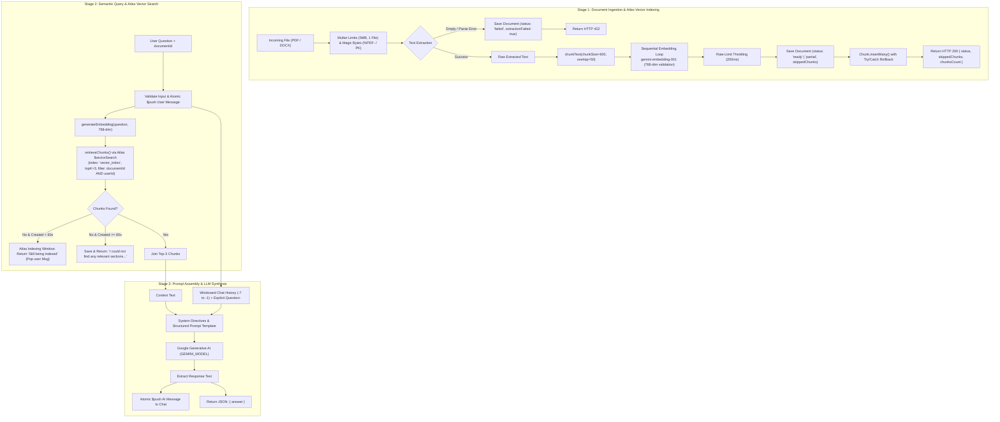

# IntelliDoc RAG Architecture Technical Report

## 1. Executive Summary & Architecture Overview

This report provides a clear, focused architectural breakdown of the **Retrieval-Augmented Generation (RAG)** pipeline of the IntelliDoc system, running natively on **MongoDB Atlas (Free M0 Tier)**. This analysis focuses strictly on document ingestion, vectorization, Atlas Vector Search storage, query processing, semantic retrieval, and response synthesis.

IntelliDoc implements a clean, robust **Vector RAG pipeline**:
1. **Sliding-Window Text Chunking** with configurable chunk sizes and overlap.
2. **Dense Vector Embeddings** powered by Google Generative AI (`gemini-embedding-001`), explicitly constrained and validated to 768 dimensions.
3. **Dedicated Retrieval Layer (`retrieval.js`)**:
   - Centralized `retrieveChunks(...)` function called by both production controller and evaluation scripts.
   - Chunks stored as standalone documents in a dedicated `chunks` collection ([ChunkModel.js](file:///c:/Users/NITIN%20SINGH/Documents/IntelliDoc/Server/models/ChunkModel.js)).
   - Vector search index (`vector_index`) configured with cosine similarity.
   - Compound pre-filtering scoped by both `documentId` and `userId` (`ObjectId`).
4. **Pure Vector Retrieval with Indexing Grace Period**:
   - Direct Approximate Nearest Neighbor (ANN) search via MongoDB Atlas `$vectorSearch`.
   - Atlas indexing propagation handling: newly created documents (< 60s) with 0 retrieved chunks prompt the user to wait briefly without polluting the chat history.
   - If no relevant sections match an established document, the system explicitly reports no relevant context found rather than hallucinating.
5. **Contextual History Augmentation**: Prior dialogue history (`slice(-7, -1)`) is cleanly partitioned from the active `Question:` and injected alongside top-$k$ retrieved chunks into `gemini-3.5-flash-lite` (configurable via `GEMINI_MODEL`).
6. **Robust Document Lifecycle**: Atomic message updates with `$push`, cascading deletion (chunks -> chat -> document) with 404 validation, and rollback on chunk insertion failures.

---

## 2. End-to-End Pipeline Architecture



---

## 3. Deep Dive: Ingestion, Chunking & Embeddings

The ingestion flow is handled by `uploadDocument` in [DocumentController.js](file:///c:/Users/NITIN%20SINGH/Documents/IntelliDoc/Server/controllers/DocumentController.js).

### 3.1 Input Validation, Buffering & Magic Byte Checks
- **Transport & Limits**: Express route `POST /api/documents/upload` backed by `multer({ storage: multer.memoryStorage(), limits: { fileSize: 5 * 1024 * 1024, files: 1 } })`.
- **Rate Limiting**: Protected by `express-rate-limit` (20 uploads per 15 minutes per IP).
- **Magic Bytes Verification**: File headers are inspected before processing:
  - PDF: starts with `%PDF-` (`0x25 0x50 0x44 0x46 0x2D`)
  - DOCX: starts with `PK` (`0x50 0x4B`)
  Invalid file payloads are rejected immediately with `HTTP 400`.

### 3.2 Text Extraction & Failure Accounting
- **PDF Extraction**: Processed via `pdfreader` event-based buffer streaming.
- **DOCX Extraction**: Processed via `mammoth.extractRawText({ buffer })`.
- **Extraction Failures**: If parser fails or extracted text is empty:
  - A Document record is saved with `status: 'failed'` and `extractionFailed: true`.
  - Endpoint returns `HTTP 422 Unprocessable Entity` with `{ message, documentId, status: 'failed' }`.
- **Partial Ingestion**: If some chunk embeddings fail, the document status is recorded as `'partial'`, accounting for `skippedChunks` and `indexedChunks`.

### 3.3 Text Chunking Algorithm
Located in [vectorUtils.js](file:///c:/Users/NITIN%20SINGH/Documents/IntelliDoc/Server/vectorUtils.js):
```javascript
export const chunkText = (text, chunkSize = 600, overlap = 50) => {
    const chunks = [];
    let start = 0;
    
    while (start < text.length) {
        const end = Math.min(start + chunkSize, text.length);
        const chunk = text.slice(start, end);
        chunks.push(chunk);
        if (end >= text.length) break;
        start = end - overlap;
    }
    
    return chunks;
};
```
- **Chunk Size ($C$)**: 600 characters.
- **Overlap ($O$)**: 50 characters ($8.33\%$ overlap ratio).
- **Step Size ($S$)**: $S = C - O = 550$ characters.

### 3.4 Vector Embedding Generation
Embedding computation is defined in [vectorUtils.js](file:///c:/Users/NITIN%20SINGH/Documents/IntelliDoc/Server/vectorUtils.js):
- **Model**: `gemini-embedding-001` via `@google/generative-ai`.
- **Dimensionality Validation**: Constrained to `outputDimensionality: 768`. The returned vector length is strictly validated (`values.length !== 768` throws an error) to prevent Atlas silently dropping misaligned vectors.
- **Retry Mechanism**: 3 maximum attempts with linear backoff.
- **Rate-Limit Throttling**: Chunks are vectorized sequentially with a $200\text{ ms}$ pause between calls.

### 3.5 Storage Architecture & Atomic Rollback
1. **Parent Document ([DocumentModel.js](file:///c:/Users/NITIN%20SINGH/Documents/IntelliDoc/Server/models/DocumentModel.js))**:
   - Stores metadata: `userId`, `filename`, `content`, `totalChunks`, `indexedChunks`, `skippedChunks`, `status`, `extractionFailed`.
2. **Chunk Collection ([ChunkModel.js](file:///c:/Users/NITIN%20SINGH/Documents/IntelliDoc/Server/models/ChunkModel.js))**:
   - Stores each chunk as an isolated document with 768-dim float embedding.
3. **Rollback Protection**: `Chunk.insertMany()` is wrapped in a try/catch block. If insertion fails, the parent document and any inserted chunks are cleaned up immediately to prevent orphaned empty documents.

---

## 4. Deep Dive: Dedicated Retrieval Layer & Semantic Search

### 4.1 Centralized Retrieval Function ([retrieval.js](file:///c:/Users/NITIN%20SINGH/Documents/IntelliDoc/Server/retrieval.js))
Production query endpoints and offline evaluation scripts execute the exact same retrieval logic:

```javascript
export async function retrieveChunks({ documentId, userId, queryEmbedding, topK = 3, numCandidates }) {
  return Chunk.aggregate([
    {
      $vectorSearch: {
        index: 'vector_index',
        path: 'embedding',
        queryVector: queryEmbedding,
        numCandidates: numCandidates ?? Math.max(30, topK * 10),
        limit: topK,
        filter: {
          $and: [
            { documentId: { $eq: oid(documentId) } },
            { userId: { $eq: oid(userId) } },
          ],
        },
      },
    },
    { $project: { text: 1, index: 1, score: { $meta: 'vectorSearchScore' } } },
  ]);
}
```

### 4.2 Indexing Race Condition Mitigation
When a user asks a question immediately after uploading, Atlas Vector Search may still be building the ANN index for the new chunks:
- If 0 chunks are returned and `Date.now() - document.createdAt.getTime() < 60_000`, the system responds:
  `"This document is still being indexed. Please try again in a few seconds."`
- The temporary user question is removed from the chat history so subsequent retries do not cause duplicate prompts.

---

## 5. Deep Dive: Prompt Engineering & Generation Layer

### 5.1 Contextual History Augmentation
- Atomic `$push` updates record messages to prevent Mongoose `VersionError` on rapid concurrent queries.
- Prior conversation history is built from `chat.messages.slice(-7, -1)`.
- The current question is explicitly appended as `Question: ${question}` to prevent query starvation in the LLM prompt.

### 5.2 Model Selection
- Powered by `gemini-3.5-flash-lite`, configurable via `process.env.GEMINI_MODEL`.

---

## 6. Document Lifecycle & Cleanup

When deleting a document (`DELETE /api/documents/:documentId`):
1. **Validation**: Validates that `documentId` is a valid MongoDB `ObjectId`.
2. **Existence Check**: Checks document ownership and returns `HTTP 404` if not found.
3. **Deletion Order**:
   - Deletes vector chunks: `Chunk.deleteMany({ documentId, userId })`
   - Deletes chat sessions: `Chat.findOneAndDelete({ userId, documentId })`
   - Deletes document metadata: `Document.findByIdAndDelete(documentId)`

---

## 7. Atlas Vector Search Index Configuration

- **Collection**: `chunks` (Database: `intellidoc`)
- **Index Name**: `vector_index`
- **Definition (JSON)**:
```json
{
  "fields": [
    {
      "type": "vector",
      "path": "embedding",
      "numDimensions": 768,
      "similarity": "cosine"
    },
    {
      "type": "filter",
      "path": "documentId"
    },
    {
      "type": "filter",
      "path": "userId"
    }
  ]
}
```
